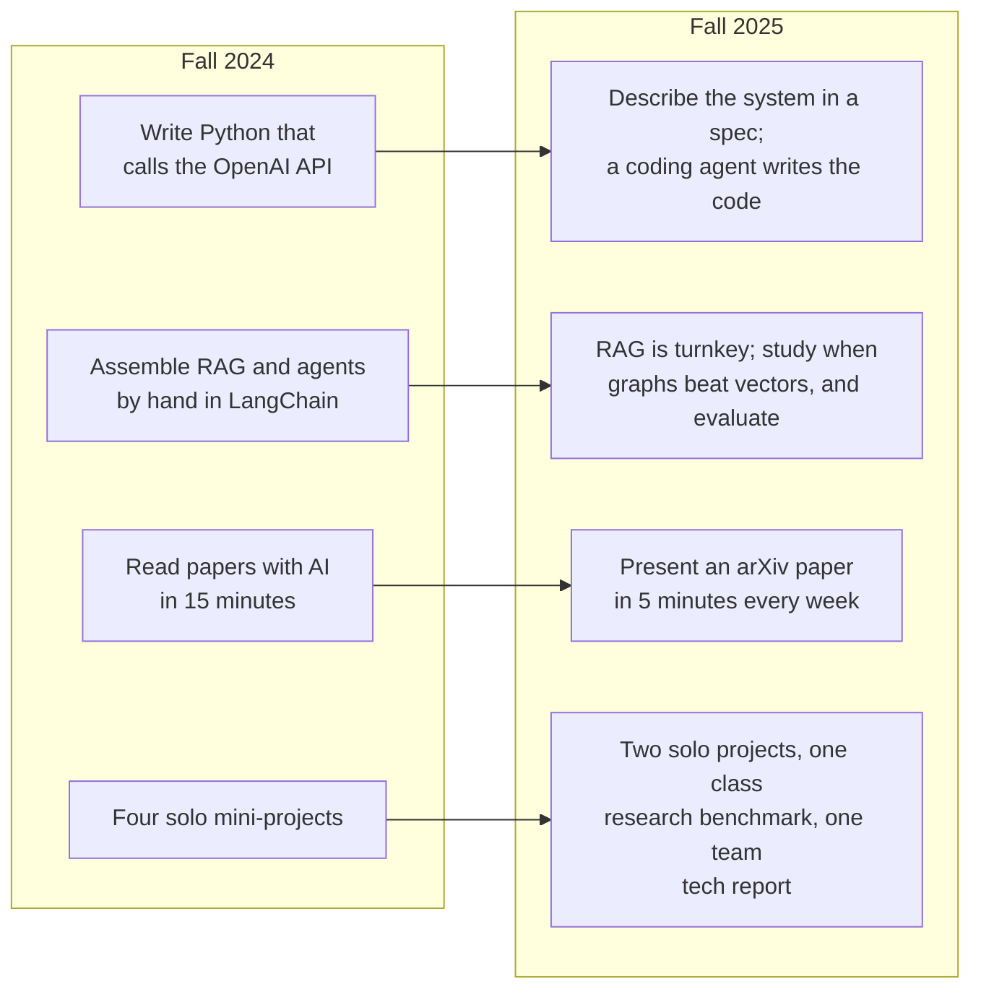
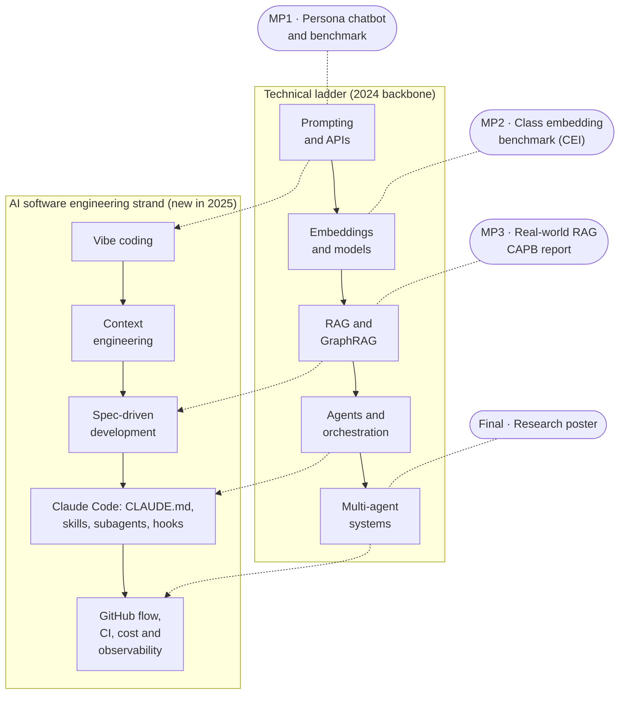
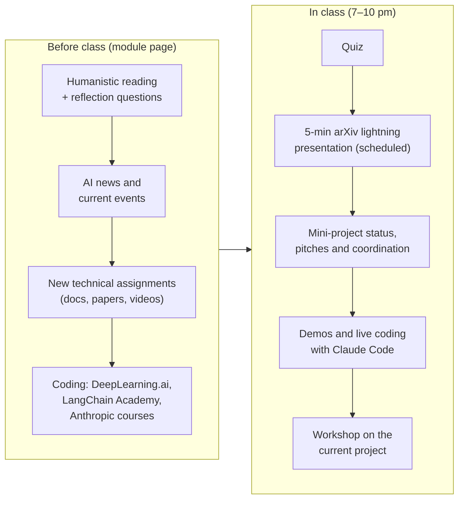
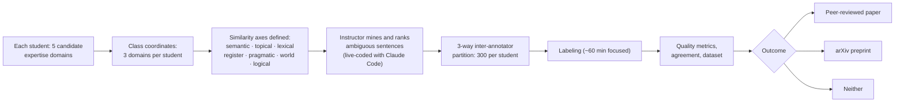
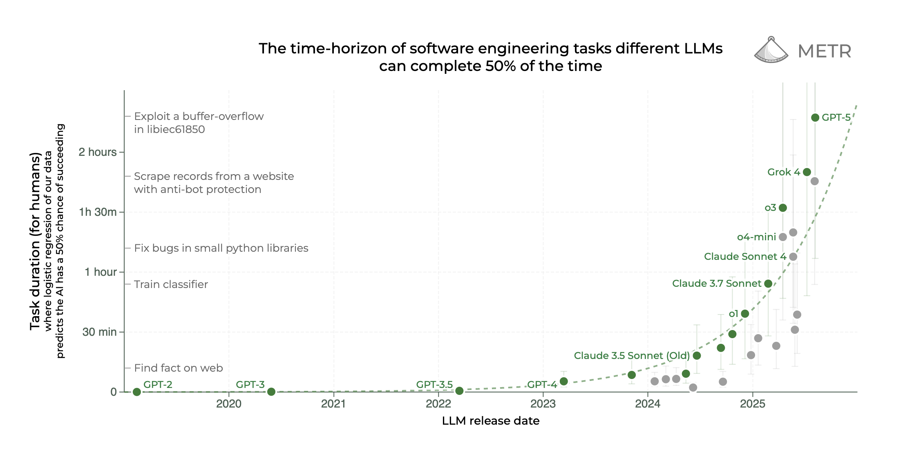
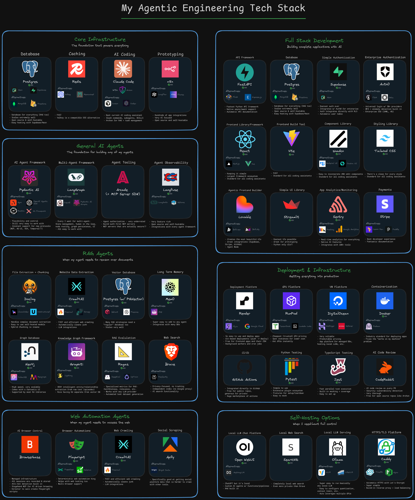
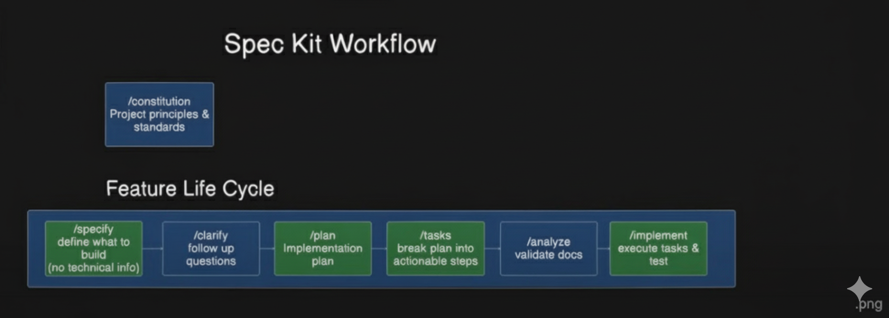
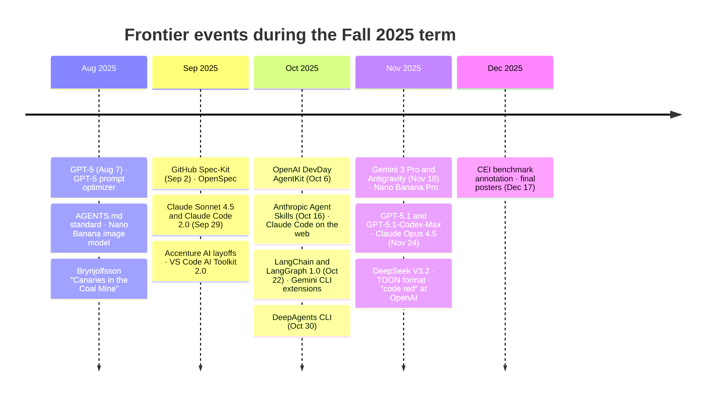
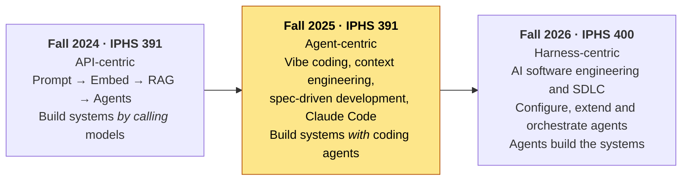

# Frontiers in AI

**Kenyon College · Integrated Program for Humane Studies (IPHS) · Fall 2025**
**IPHS 391 (Special Topics) · Instructor: Jon Chun**

This repository is the archived record of the second offering of *Frontiers in AI*, taught at Kenyon College in Fall 2025 under the special-topics number IPHS 391 ("Frontiers in Generative AI"). It documents the semester in which the course's center of gravity moved from calling model APIs to working alongside AI coding agents: GPT-5, Claude Sonnet 4.5 and Claude Code 2.0, Agent Skills, OpenAI's AgentKit, LangChain 1.0, Gemini 3 and Antigravity all arrived during the term, and the course absorbed each within a week of release.

The first offering was Fall 2024 ([archived here](https://github.com/jon-chun/iphs391-2024fall-frontiers-in-ai)). After this second offering the course was approved as a permanent course and became **IPHS 400: Frontiers in AI** from Fall 2026 ([course site](https://theailab.net)). All three are the same course under slightly different names and numbers; this README ends with a comparison across them.

| | |
|---|---|
| **Course** | IPHS 391: Frontiers in Generative AI (special topics; second offering) |
| **Term** | Fall 2025, Wednesdays 7:00–10:00 pm, Timberlake #5 (Evans Conference Room) |
| **Credit / CRN** | 0.5 unit (4 credit) · Section 00 · CRN 80637 |
| **Enrollment** | 10 students |
| **Prerequisite** | Introductory Python |
| **Office hours** | Tu/Th 10:30–noon or by appointment |
| **Syllabus** | [syllabus.md](syllabus.md) · [Fall 2025 PDF](syllabus_iphs391_frontiers_in_genai_2025fall_chunj.pdf) · [Fall 2024 PDF](syllabus_iphs391_frontiers_in_genai_2024fall_chunj.pdf) |
| **2024 student reviews** | [Anonymous reviews of the first offering (PDF)](docs/student_reviews_IPHS39SpecialTopicAIFrontiersLLMAutonomousWorkflows_fall2024_JonChun.pdf) |
| **Related repos** | [Fall 2024 archive](https://github.com/jon-chun/iphs391-2024fall-frontiers-in-ai) · [MP3 group report repo](https://github.com/jon-chun/iphs391-mp3-agentic-rag-system-report) · [Fall 2026 site](https://github.com/jon-chun/theailab-net) |

> **Archive note.** This repository was the live course site for both the 2024 and 2025 offerings; the 2025 term overwrote most of the 2024 weekly pages, which is why the 2024 version was recovered into its own repository. The README this file replaced is preserved verbatim at [docs/README_original_fall2025.md](docs/README_original_fall2025.md). The weekly module pages under [modules/](modules/) are unchanged and remain the primary record of each class.

---

## Contents

1. [Motivation and philosophy](#1-motivation-and-philosophy)
2. [What changed from 2024](#2-what-changed-from-2024)
3. [Course design: the ladder, with coding agents woven through](#3-course-design-the-ladder-with-coding-agents-woven-through)
4. [Weekly schedule](#4-weekly-schedule)
5. [How a class week worked](#5-how-a-class-week-worked)
6. [Projects and grading](#6-projects-and-grading)
7. [The state of the art, Fall 2025](#7-the-state-of-the-art-fall-2025)
8. [What changed mid-semester](#8-what-changed-mid-semester)
9. [Outcomes and lessons from the second offering](#9-outcomes-and-lessons-from-the-second-offering)
10. [The course across three years: 2024 → 2025 → 2026](#10-the-course-across-three-years-2024--2025--2026)
11. [Repository guide](#11-repository-guide)

---

## 1. Motivation and philosophy

The motivation was unchanged from 2024, and so was the question on the first page: how is AI changing humanity, and can the current generation of rapidly improving autonomous agents craft novels, political campaigns, marketing strategies, analyst reports, software, music videos, or original scientific research? What changed was the answer. In 2024 the honest reply was "partly, with a lot of plumbing." By September 2025, with Claude Code and its peers able to carry multi-hour coding tasks, the course's working assumption became that the plumbing is the agent's job and the student's job is to specify, steer, verify and judge.

The three commitments from the first offering carried over:

- **Top-down, not bottom-up.** Start from real-world problems at a high level of abstraction; supply a framework each student can deepen according to their own preparation. No mathematics beyond high school.
- **Human-centered and interdisciplinary.** IPHS students come from every division; projects were customized to each student's domain expertise. This year that principle was made literal in Mini-Project 2, where each student's *domain expertise* (a major, a language, a subculture, a job) was the raw material for a research benchmark.
- **Authentic, portfolio-building assessment.** Every student leaves with public GitHub repositories, professional READMEs, and a research poster published to [digital.kenyon.edu/dh](https://digital.kenyon.edu/dh/).

Two ideas were new in the framing. First, **"drink from the AI firehose"**: the week-2 goals list begins with learning to track news, research and product launches as a skill, because the material would change under the students' feet (it did; see [§8](#8-what-changed-mid-semester)). Second, **deterministic traditional programming vs stochastic AI programming**: the course now treated software engineering discipline (PRDs, decomposition, test-driven development, benchmarks, observability) as the thing that makes stochastic components usable, which set up spec-driven development as a recurring theme.

## 2. What changed from 2024



| Aspect | 2024 | 2025 |
|---|---|---|
| Development environment | Google Colab, Kaggle; local optional | Local laptop configured in week 2: Homebrew/WSL2, iTerm2 or Windows Terminal, git and SSH, `uv`, Node, VS Code, and CLI coding agents (Claude Code, Gemini CLI, OpenCode, Warp) |
| Coding method | Hand-written Python from DeepLearning.ai notebooks | Prompt engineering → vibe coding → context engineering → spec-driven development (BMAD, GitHub Spec-Kit, OpenSpec, Task-Master), executed through coding agents |
| Project 1 | Build a persona chatbot | Build a persona chatbot, then **use AI to design a rubric and benchmark it** |
| Project 2 | Individual Gradio app on embeddings | **Class-wide research**: a novel embedding benchmark of expert-labeled, semantically ambiguous sentences, with 3-way inter-annotator agreement, aimed at an arXiv preprint or publication |
| Project 3 | Customize a LangGraph agent | **Real-world RAG design**: team task reports plus an individual Composable AI Project Blueprint (CAPB) tech report, modeled on industry ADRs and solution-architecture documents |
| Agent frameworks | LangChain, LangGraph, CrewAI, Swarm, AutoGen | LangChain/LangGraph 1.0, LangSmith, DeepAgents; OpenAI AgentKit; Claude Code subagents, hooks and skills; HumanLayer |
| Weekly presentations | Two students per week, loosely defined | A scheduled **5-minute arXiv lightning presentation** per student, with AI-assisted slide generation (Gamma, Kimi, Copilot) |
| Cost to student | ~$100–150 | ~$180: OpenAI, Colab, Anthropic, plus free Gemini-for-students and Perplexity referral months (the class optimized referrals together) |

## 3. Course design: the ladder, with coding agents woven through

The 2024 ladder (prompting → embeddings → RAG → agents → multi-agent systems) remained the backbone, but a second strand, *AI-assisted software engineering*, ran alongside it from week 2 and gradually took over the in-class time.



The humanistic track also deepened. Every week opened with a *Humanistic Big Ideas* reading and written reflection prompts: Demis Hassabis and Joscha Bach on the future of work and mind; Brynjolfsson's *Canaries in the Coal Mine* on early-career employment effects; Emad Mostaque on AI and capitalism; the Zitron bear case and its rebuttals; AI art (The Oatmeal); the chatbot-and-minors lawsuits; "AI is hollowing out higher education"; the Chinese AI ecosystem; and the Bloomberg "AI money ouroboros."

## 4. Weekly schedule

Each row links to the module page that was the actual class handout.

| Wk | Date | Topic | Core technical content | Humanistic / news thread | Module |
|---:|---|---|---|---|---|
| 1 | Sep 3 | Introduction and AI overview | Intake survey; the IPHS human-centered AI sequence; demos (Claude prompt-creator artifact, Nano Banana in AI Studio, leaked system prompts, NotebookLM, Google Opal, Suno, Veo 3 Flow, CrewAI templates); group ideation of agent workflows | Reflection themes: AI as civilization-shaping force; future of work; interdisciplinary innovation | [week1](modules/week1_ai_overview.md) |
| 2 | Sep 10 | Prompt engineering, vibe coding, context engineering, spec-driven development | Web UI vs API; laptop setup (brew/WSL2, uv, git, CLI agents); Ollama + LangExtract in Colab; SDLC from waterfall to agile; **BMAD** agentic agile method; GPT-5 prompt optimizer; Mei et al. *Survey of Context Engineering* read with AI | Hassabis on the future of work; "Workers don't trust their companies on AI" | [week2](modules/week2_prompting.md) |
| 3 | Sep 17 | **Mini-Project 1: Chatbots** | GPT-5 structured prompts and the Codex prompting guide; Microsoft **POML**; local Ollama API; spec-driven resume/job optimization; GitIngest for brownfield code; rulebook-ai; Task-Master vs BMAD walk-through | Brynjolfsson *Canaries in the Coal Mine*; Zitron's *Hater's Guide to the AI Bubble*; ParaThinker; multi-agent debate failure modes | [week3](modules/week3_miniproject1_chatbot.md) |
| 4 | Sep 24 | Embeddings | Semantic vector spaces; MTEB; `uv`; VS Code AI Toolkit; GLM coding plan; **GitHub Spec-Kit** with Claude Code; context-engineering token discipline | Joscha Bach at the Artificiality Summit; Anthropic economic report; "5 signs the AI bubble is bursting" | [week4](modules/week4_embeddings.md) |
| 5 | Oct 1 | LangChain and models · MP2 kickoff | MTEB and MMTEB papers; Qwen3-Omni; 20 Claude Code tips (plan mode, CLAUDE.md, slash commands, subagents, hooks, MCP, parallel sessions); LangChain for LLM apps; MP2 domain brainstorming | Mostaque on AI and capitalism; "5,000 agent teams at Citi"; how to write a CS paper | [week5](modules/week5_models.md) |
| 6 | Oct 8 | **Mini-Project 2**, Claude Code 2.0 and the AI Toolkit | **Claude Sonnet 4.5 and Claude Code 2.0** (Sep 29); MCP; best embedding models for retrieval 2025; agentic engineering lessons; analyzing the leaked Sonnet 4.5 system prompt with AI | "90% of code by AI" prediction audited; Justine Bateman on AI actors; Accenture layoffs | [week6](modules/week6_miniproject2.md) |
| 7 | Oct 15 | RAG · MP3 pivot to a real customer-service agent | **OpenAI DevDay AgentKit** (Oct 6): Agent Builder, ChatKit, Guardrails, Evals and trace grading, reinforcement fine-tuning, Responses API; RAG tradeoffs (hybrid search, reranking) | The Oatmeal on AI art; CEOs on AI ROI; Google DORA 2025 state of AI-assisted development | [week7](modules/week7_rag.md) |
| 8 | Oct 22 | Advanced RAG and GraphRAG | Microsoft GraphRAG, LightRAG, RAG-Anything, HiRAG; *When to use Graphs in RAG* benchmark; Spec-Kit (greenfield) vs OpenSpec (brownfield); agentic knowledge-graph construction | Star Trek's Data and sci-fi AI; chatbot-and-minors lawsuits; Agents4Science conference | [week8](modules/week8_miniproject3-rag-graphrag.md) |
| 9 | Oct 29 | Claude Code, CLI development and SDD | **Agent Skills** (Oct 16); AGENTS.md; Claude Code on the web; Gemini CLI extensions; OpenCode; GitHub Skills courses (PRs, merge conflicts); BMAD vs Spec-Kit vs OpenSpec; agent memory | "AI is hollowing out higher education"; "a golden age of stupidity?"; OpenAI's browser | [week9](modules/week9_claude-code.md) |
| 10 | Nov 5 | MAS, orchestration and the IT project proposal | **LangChain and LangGraph 1.0** (Oct 22); LangSmith; frameworks vs runtimes vs harnesses; HumanLayer CodeLayer; Deep Agents from scratch; "how to fix your context"; MP3 pitch and the CAPB report | "AI is 96% cheaper"; *How Do AI Agents Do Human Work?*; federal judges caught using ChatGPT | [week10](modules/week10_mas-orchestration-mp3.md) |
| 11 | Nov 12 | Agent observability, optimization and security | zsh dotfiles and XDG; LangChain DeepAgents CLI; a live three-hour full-stack RAG agent build (YouTube-RAG personal coach); control flow, hooks and traces in LangGraph | Mostaque; "build on OpenAI at your own risk"; the Chinese AI iceberg | [week11](modules/week11_observability-optimization-security.md) |
| 12 | Nov 19 | Subagents, GitHub workflows and benchmarks | Claude Code custom skills and subagents; GitHub Flow, Actions and a "merge to main" workflow; modern CLI toolkit (ripgrep, fzf, bat, eza, tmux, zoxide…); cost tracking (ccusage); context formats (TOON, llm-min); SpecStory and session metrics | "The AI tech layoff lie"; the AI money ouroboros; state legislatures on AI | [week12](modules/week12_subagents-github-benchmarks.md) |
| — | Nov 26 | Thanksgiving break | | | |
| 13 | Dec 3 | Meta-coding and research | **Gemini 3, Antigravity, Nano Banana Pro, GPT-5.1-Codex-Max, Opus 4.5** (all within days); million-step LLM tasks with zero errors; Code Wiki; skills that write skills; Agent OS vs BMAD vs Spec-Kit; product evals; **CEI benchmark annotation** for MP2 | Chapin on learning to be socially normal; "so you want a PhD in AI"; Altman's "code red" | [week13](modules/week13_ai_meta-coding_research.md) |
| 14 | Dec 10 | AI and the future · final project | Closing the loop from BMAD to fully autonomous, parallel multi-agent coding; Obsidian and Zotero; MP2 annotation debrief | Retrospective on a semester of constant change | [week14](modules/week14_future.md) |
| 15 | Dec 17 | Final project due (exam week) | Poster, code and data submitted by 6:30 pm | | |

Dates are the Wednesday class meetings reconstructed from the module pages and commit history; the module pages are the authoritative record.

## 5. How a class week worked

The weekly rhythm kept the 2024 shape and added two fixed elements: a humanistic reading with written reflection prompts at the top of every page, and a scheduled lightning presentation.



Habits that were deliberate pedagogy:

- **AI-assisted technical skimming, examined.** Week 2 assigned eight specific pages of a 60-page context-engineering survey and promised to dissect it in class, "a methodology to use AI to query, explain, and enter into dialog with contents and concepts." Later weeks repeated the pattern with GraphRAG papers, the million-step-task paper and Hacker News threads, with the instruction to "selectively and deftly use AI to analyze, summarize and do personalized interactive Q&A."
- **Lightning presentations.** Each student chose an arXiv paper related to their field, read abstract/introduction/background/conclusion, synthesized the rest with AI, and produced a 5–7 slide deck with Gamma, Kimi or PowerPoint Copilot. The schedule ran from week 4 through week 13.
- **Live coding of the class research project.** From week 6 the instructor live-coded parts of the MP2 benchmark tooling in class with Claude Code and the VS Code AI Toolkit, so students saw spec-driven agentic development applied to real research code.
- **Reading leaked system prompts.** Persona prompting (MP1) and SDD were taught partly by analyzing leaked production prompts (xAI personas, Claude Sonnet 4.5) with AI: what makes a 10k-word system prompt work?

## 6. Projects and grading

| Component | Weight |
|---|---:|
| Class participation (including the lightning presentation) | 20% |
| Weekly quizzes | 30% |
| Mini-projects | 30% |
| Final project (original interdisciplinary research, poster) | 20% |

As in 2024, the class voted to fold Mini-Project 4 into the final project, which therefore carried 30% (10% + 20%).

### Mini-Project 1: Benchmarking expert chatbot personas

Build a chatbot with a distinctive, domain-expert persona using the OpenAI API in Colab, then **evaluate it**. Deliverables formed a small reproducible research package in a public repo: the meta-prompt iteration history, the final persona prompt, the best 10-turn conversation, a ChatGPT-developed scoring rubric (a weighted linear combination of 4–6 factors such as consistency, depth, authenticity, creativity, engagement), a 6-section analysis report, and an AI-generated README as the landing page. Graded on prompt complexity, subtlety, creativity and measured effectiveness. Due September 28. Full spec: [miniproject1_instructions_persona-chatbot-and-benchmark.md](modules/miniproject1_instructions_persona-chatbot-and-benchmark.md).

### Mini-Project 2: A class-built embedding benchmark (CEI)

A collective research project rather than ten individual apps. Each student proposed five domains in which they could "reliably spot edge cases and rank similarity of domain texts better than most people" because of their background (academic genres, bureaucratic language, niche hobbies, multilingual and dialectal text, technical writing, creative forms…), and the class coordinated to pick three per person for coverage. Students then labeled sentence pairs and anchor-triplets along explicit axes of similarity (semantic, topical, lexical, stylistic/register, pragmatic, world-knowledge, temporal/numerical/logical), with the goal that at least half the hard items "hinge on subtle distinctions that confuse non-experts and today's AIs."

By week 13 the instructor had built a library to mine and rank semantically ambiguous standalone sentences, generated the candidate pool, and partitioned it in a three-way inter-annotator scheme: 300 sentences per student, 100 net contribution each, graded on completeness and on post-processed quality metrics. The stated outcomes were a peer-reviewed paper, an arXiv preprint, or neither, depending on data quality; the point was for students to work as a research team with a co-authorship at stake.



### Mini-Project 3: Real-world RAG, from pitch to tech report

MP3 changed three times, each time tracking the field (see [§8](#8-what-changed-mid-semester)): a simple RAG app (syllabus) → a commercial customer-service agent pipeline on OpenAI's newly released AgentKit, prompted by a possible deployment with an IPHS alumnus's parts-distribution company (week 7) → RAG vs GraphRAG benchmark analysis (week 8) → its final form, **"RAG in a Real-World Implementation."** Students pitched a corpus they knew well and a deployment use case, split group sub-tasks whose reports were pooled in a shared repository ([iphs391-mp3-agentic-rag-system-report](https://github.com/jon-chun/iphs391-mp3-agentic-rag-system-report), due November 7), and then each wrote an individual **Composable AI Project Blueprint (CAPB)** report (due November 16): project context, data and constraints, RAG architecture, a component bake-off with justified alternatives, an evaluation plan, risks and future work, in Markdown with YAML snippets. The rubric ([overview_and_rubric.md](code/tech-reports/overview_and_rubric.md), [skeleton](code/tech-reports/student_report_skeleton.md)) graded analysis and justification, not production readiness, and was explicitly modeled on ADRs, RFCs and solution-architecture documents.

### Final project

An original interdisciplinary research project applying at least one course technology, as a PowerPoint research poster in the IPHS template for publication to [digital.kenyon.edu/dh](https://digital.kenyon.edu/dh/), with code and data for originality checking. New in 2025: required sections for *Declaration of AI Use* and *Author Contributions*, ACM-format references, and the rule that text clearly written by AI would be downgraded and made ineligible for Digital Kenyon. Due December 17 at 6:30 pm, the exam-week deadline. Guidance: [week14_future.md](modules/week14_future.md), [ai_final_project.md](modules/ai_final_project.md).

## 7. The state of the art, Fall 2025

A reference snapshot drawn from what the modules assigned and demonstrated.

### Models

| Area | What students used or studied | Notes |
|---|---|---|
| Frontier LLMs | **GPT-5** (Aug 7) and GPT-5-Codex, **GPT-5.1** and GPT-5.1-Codex-Max (Nov); **Claude Sonnet 4.5** (Sep 29) and **Opus 4.5** (Nov 24); Gemini 2.5 Pro then **Gemini 3 Pro** (Nov 18); Grok 4 | Students had three API vendors (OpenAI, Google, Anthropic) and OpenRouter/Requesty as flexible routers |
| Open-weight LLMs | Qwen3-Coder and Qwen3-Omni; GLM-4.5/4.6 (the "GLM coding plan"); DeepSeek V3.2; Kimi K2; Llama via Ollama | Chinese open models were covered as a geopolitical and economic story, not only a technical one ("The Chinese AI Iceberg") |
| Multimodal | Nano Banana (Gemini 2.5 Flash Image, Aug) and Nano Banana Pro (Nov); Veo 3 and Flow; Suno; Qwen3-Omni | Week-1 demos and the "step-function" news of week 13 |
| Embeddings | MTEB and MMTEB (multilingual, Feb 2025); 2025 retrieval-model comparisons; sentence embeddings | The organizing benchmark for MP2 |
| Reasoning and test-time compute | ParaThinker (native parallel thinking); multi-agent-debate failure modes; *Solving a Million-Step LLM Task with Zero Errors*; METR's long-task horizon curve | Read with AI for the big ideas; the METR figure is in [images/ai-progress](images/ai-progress/) |



*Figure: METR's March 2025 measurement of the length of tasks AI agents can complete, doubling roughly every seven months. In class this was the chart behind "the plumbing is now the agent's job."*

### Frameworks, tooling and protocols

| Layer | 2025 state |
|---|---|
| AI coding agents | **Claude Code** (CLI; 2.0 with Sonnet 4.5; subagents, hooks, custom slash commands, **Agent Skills** from Oct 16, Claude Code on the web); OpenAI Codex CLI; Gemini CLI (extensions, Genkit, sub-agents); OpenCode; Cursor, Windsurf, Warp, Roo/Kilo Code in VS Code; Google **Antigravity** (Nov) |
| Agent configuration | `CLAUDE.md`, `AGENTS.md` (cross-tool standard, Aug/Sep), rulebook-ai, skills (`SKILL.md`), MCP servers and plugins |
| Spec-driven development | BMAD Method (PM → architect → scrum master → dev → QA agents), Task-Master, GitHub **Spec-Kit** (Sep 2) for greenfield, **OpenSpec** for brownfield, Agent OS; the "Chain of Vibes" and "The New Code" (specs as the real source) arguments |
| Context engineering | Mei et al. survey; "how to fix your context"; token-efficient formats (TOON, llm-min, SICK); session distillation (SpecStory, sniffly); cost monitoring (ccusage) |
| Agent frameworks and runtimes | **LangChain and LangGraph 1.0** (Oct 22); LangSmith; DeepAgents and DeepAgents CLI; LangChain's "frameworks vs runtimes vs harnesses" framing; HumanLayer CodeLayer; CrewAI templates |
| OpenAI agent platform | **AgentKit** (Oct 6): Agent Builder, ChatKit, Guardrails, connector registry; Responses API; Evals with trace grading; reinforcement fine-tuning with custom graders |
| RAG | Turnkey basic RAG; GraphRAG, LightRAG, RAG-Anything, HiRAG; GraphRAG-Bench (*When to use Graphs in RAG*); RAGAS; the Awesome-RAG ecosystem |
| Research tooling | Deep-research modes in every major assistant; NotebookLM; ScholarQA, Consensus; Gamma and Kimi slides; Zotero, Obsidian; Agents4Science (AI as author and reviewer) |
| Dev environment | Homebrew / WSL2, `uv`, nvm, iTerm2/Ghostty, tmux, modern Rust CLI tools, GitHub Flow and Actions, git-lfs |
| Benchmarks | MTEB/MMTEB, Aider leaderboard, GraphRAG-Bench, product evals, LLM-as-judge rubrics (MP1) |



*Figure: the agentic technology stack as presented in November 2025, from models and runtimes up through harnesses, orchestration and applications.*



*Figure: the GitHub Spec-Kit workflow (specify → clarify → plan → tasks → implement) that anchored the spec-driven development thread from week 4.*

### Discourse

The non-technical readings of 2025 are noticeably more divided than 2024's. Optimist and skeptic cases were assigned side by side (Hassabis and Mostaque against Zitron; "AI skepticism is cancelled" against "5 signs the bubble is bursting"), labor evidence arrived from economists rather than pundits (Brynjolfsson's *Canaries*, DORA 2025, Stanford's *How Do AI Agents Do Human Work?*), and the course added higher education itself to the list of institutions under pressure.

## 8. What changed mid-semester



Course changes that followed, in the order they happened:

1. **Week 2** added Claude Code, Gemini CLI, OpenCode and Warp to the laptop setup, and BMAD to the readings, because "vibe coding" had become a professional workflow over the summer.
2. **Week 7** was rewritten within a week of OpenAI DevDay: Mini-Project 3 pivoted from a simple RAG app to a customer-service agent pipeline on AgentKit, Guardrails and Evals.
3. **Week 8** added Spec-Kit vs OpenSpec and a long troubleshooting guide for Spec-Kit with Roo/Kilo Code, written after students hit installation problems.
4. **Week 9** was "interrupted by a slew of fundamental and significant new product announcements" and pivoted entirely to Agent Skills and Claude Code, which the page says were "fundamentally reshaping AI-assisted coding."
5. **Week 10** absorbed LangChain 1.0 and its "frameworks, runtimes and harnesses" framing within two weeks of release; MP3 settled into its final CAPB form.
6. **Week 13** opened with Gemini 3, Antigravity, Nano Banana Pro and GPT-5.1-Codex-Max, "released in the past 48 hours," as "an apt coda to our semester at the Frontiers of AI."

## 9. Outcomes and lessons from the second offering

- **Local-first development paid off.** Moving students off Colab onto configured laptops in week 2 cost a hard week but made every later tool (Claude Code, Spec-Kit, Gemini CLI, GitHub Flow, the CLI toolkit) available. In 2026 this became Mini-Project 1 in its own right.
- **Evaluation became a first-class skill.** MP1 asked students to build a rubric before judging their chatbot; MP2 made them annotators in an inter-annotator-agreement scheme; MP3 required an evaluation plan and a component bake-off. The through-line is that with stochastic systems, the student's leverage is in specification and measurement.
- **Collective research is feasible in a 10-person seminar.** The CEI benchmark turned individual domain expertise into a shared dataset with a publication path. The cost was coordination overhead: MP2 was announced in week 5 and annotated in week 13, with the final dataset deferred to the break.
- **Projects should track the frontier, within limits.** MP3's three pivots gave students a real taste of greenfield ambiguity and a professional document type (CAPB) they could reuse, but also compressed the actual build time; the 2026 course fixed this by publishing starter repositories and manuals per project.
- **Frameworks lost ground to harnesses.** LangChain was still taught (and reached 1.0), but in-class time shifted to Claude Code's skills, subagents and hooks, to GitHub as the hub of the AI-SDLC, and to cost and context management. The 2026 syllabus made this official: "hand-wired API integrations and hand-assembled RAG stacks" are "now commodity work, and mostly something the agents can do themselves."
- **Permanent status.** The second offering supported the RAS committee's approval of the course as IPHS 400, taught twice weekly for full credit from Fall 2026.

## 10. The course across three years: 2024 → 2025 → 2026

The same course, rebuilt each year around whatever the frontier had become. Read across, the three offerings record how "building with AI" changed from calling an API, to steering an agent, to engineering the harness around fleets of agents.



| Dimension | Fall 2024 | Fall 2025 (this repo) | Fall 2026 |
|---|---|---|---|
| Number and status | IPHS 391, special topics, first offering | IPHS 391, special topics, second offering | **IPHS 400, permanent course** (RAS-approved) |
| Format | Wed 7–10 pm, 0.5 unit, 15 students | Wed 7–10 pm, 0.5 unit, 10 students | Tu/Th 2:40–4:00, 4 credits; prereq IPHS 200 or COMP 118 |
| Course site | GitHub README + module pages | GitHub README + module pages | [theailab.net](https://theailab.net), a login-gated site built with the course's own AI-SWE workflow |
| Organizing idea | Four technologies on an abstraction ladder | Same ladder, with AI coding agents and spec-driven development woven through | AI software engineering: harness engineering across a professional SDLC |
| Primary tool | OpenAI API in Colab/Jupyter | OpenAI/Gemini/Anthropic APIs plus Claude Code, Gemini CLI, OpenCode, VS Code | Claude Code CLI (primary agent), VS Code, GitHub, OpenRouter |
| Dev environment | Colab, Kaggle; local optional | Local laptop setup week 2 (brew/WSL2, uv, git, CLI IDEs) | MP1 *is* the environment: dotfiles, zsh, XDG, secrets hygiene |
| MP1 | Persona chatbot | Persona chatbot **plus an AI-built scoring rubric and report** | Dev-environment configuration and a website redesign (pass/no-pass) |
| MP2 | Gradio multi-model app on embeddings | **Collective research**: a class-built embedding benchmark of expert-labeled hard sentence pairs, aimed at publication | Web CMS built spec-first with tickets, tests, reviews, handoffs and a token ledger |
| MP3 | LangGraph agent customized to a workflow | Real-world RAG/GraphRAG design: group task reports plus an individual CAPB tech report | **AI Research Factory**: an agent pipeline that reads an arXiv methods paper, finds a gap, runs an experiment and drafts a paper the student audits |
| MP4 | CrewAI workflow, folded into final | Folded into final | TBA, 10% |
| Final | Research poster to digital.kenyon.edu/dh | Same, with declaration of AI use and ACM references | Same, with a proposal gate, a release form, and a written-exam alternative |
| Reading method | 15-min AI-assisted paper reading | Lightning arXiv presentations every week | Lightning presentations; skim-and-query with AI explicitly examined |
| Agent frameworks taught | LangChain, LangGraph, CrewAI, Swarm, AutoGen | LangChain/LangGraph 1.0, LangSmith, DeepAgents, OpenAI AgentKit, Claude Code subagents and skills | Claude Code skills, hooks, plugins, subagents, MCP; ARIS; Pocock/Pstack skill packs; DeepSeek and Google harnesses |
| Frontier models at the time | GPT-4o, o1-preview, Claude 3.5 Sonnet, Llama 3.1/3.2, Gemini 1.5 | GPT-5 and 5.1, Claude Sonnet 4.5 and Opus 4.5, Gemini 2.5 and 3, Qwen3, DeepSeek V3.2 | Claude Opus/Sonnet/Haiku 5.5, GPT-6, DeepSeek v4.1, open "RSI" coding models (Flint) |
| Defining mid-term event | o1 reasoning models; MCP announced | Agent Skills; AgentKit; LangChain 1.0; Gemini 3 and Antigravity | Harness engineering goes mainstream; "pace the frontier" debate |
| Secrets and safety | API budget caps | API budget caps; leaked-system-prompt analysis | Formal secrets-hygiene and least-privilege agent rules, graded |
| Cost to student | ~$100–150 (OpenAI, Colab) | ~$180 (OpenAI, Colab, Anthropic; free Gemini and Perplexity student tiers) | ~$150 (Claude subscription plus small API credit) |

Two through-lines never changed: the humanistic track on labor, ethics and what agentic systems do to knowledge work, and the final deliverable of an original, interdisciplinary, publicly published research project.

## 11. Repository guide

```
.
├── README.md                              # this file
├── syllabus.md                            # syllabus (markdown; 2024 text, unchanged for 2025)
├── syllabus_iphs391_…_2025fall_chunj.pdf  # Fall 2025 syllabus
├── syllabus_iphs391_…_2024fall_chunj.pdf  # Fall 2024 syllabus
├── modules/
│   ├── week1_ai_overview.md … week14_future.md       # one page per week (Fall 2025)
│   ├── miniproject1_instructions_…md                 # MP1 full specification
│   ├── miniproject2_instructions_embeddings_benchmark/
│   ├── ai_fall2025_readings.md                       # summer 2025 course planning outline
│   ├── ai_claude_code.md, ai_vibe-prompts.md, ai_mcp.md, ai_agents-multi.md, …
│   ├── ai_*.md                                       # ~100 curated topic reference pages
│   └── weekn_notes_fall2025.md, weekx_template.md
├── code/
│   ├── notebooks/                         # course Colab notebooks (2024 and 2025)
│   ├── tech-reports/                      # MP3 CAPB overview, rubric and report skeleton
│   ├── deeplearningai/                    # DeepLearning.ai course notebooks
│   └── acl2024/                           # EMNLP/CoNLL 2024 materials
├── docs/                                  # 2024 student reviews, MCP/n8n/Docker/Ollama notes,
│                                          #   leaked Sonnet 4.5 prompt, this README's predecessor
├── docs-config/                           # Sept 2025 cross-platform AI dev-setup guides (GPT-5, Perplexity)
├── docs-reports/                          # DORA 2025, PwC, OpenAI agents guide, Gemini roadmap
├── docs-research/, docs-slides/, deepresearch/
├── images/                                # figures: SWE/agentic stack, spec-driven dev, Claude Code,
│                                          #   METR long tasks, economics, 2024 RAG/CrewAI slides
├── exercises/, demos/, data/, articles/, paper_figures/, tests/
└── chats/                                 # saved AI chat sessions used in class
```

Secrets were scrubbed from this repository's history before archiving; API keys in three saved notebooks were replaced with placeholders. The `.env-openai-api.sh` file contains only a placeholder.

---

*Jon Chun · Kenyon College · [chunj@kenyon.edu](mailto:chunj@kenyon.edu) · [Faculty page](https://www.kenyon.edu/directory/jon-chun/) · [github.com/jon-chun](https://github.com/jon-chun) · More on the IPHS human-centered AI curriculum and mentored student research at [digital.kenyon.edu/dh](https://digital.kenyon.edu/dh/).*
